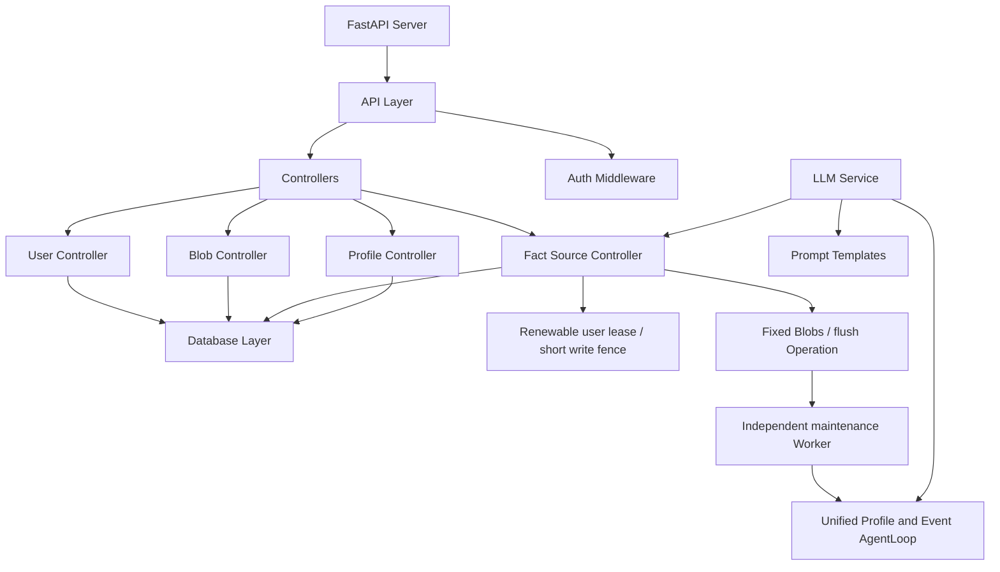
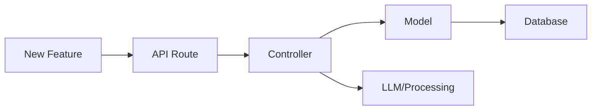

# Memoia Architecture Guide

<!-- Modified for Memoia: corrected package layout and maintenance boundary. -->

Implementation modules below live under `src/server/api/memoia_server/`; the
ASGI entry point is the sibling `src/server/api/api.py`. The only maintained SDK
is `@jianify/memoia` under `sdks/typescript/`; upstream SDKs have been retired.

可靠来源写入、证据撤回、幂等恢复及检索边界以 [API-DESIGN.md](API-DESIGN.md)
为准；协议由 `export-openapi.py openapi.json` 生成，TypeScript SDK 位于
`sdks/typescript/`。只支持唯一 `/api` 和 `@jianify/memoia` SDK；软件版本和历史迁移编号不表示多套运行时协议。
数据库只能经显式 [Alembic 链](migrations/README) 修改；import 不执行 DDL。

## Project Overview

Memoia is a user memory system derived from Memobase. Sources and evidence are the truth; profiles and events are derived memories. This guide describes the module layout; API-DESIGN defines the current processing contracts.

Derived `fact_ids` are actual evidence, not a complete influence map. The existing read set also
produces an internal JSON influence scope, inherited through read Profile/Event text. Fact
corrections/deletions invalidate affected derived revisions in their transaction; the existing flush
must resolve that scope with explicit keep/update/remove decisions before committing, not default
deletion. Keep preserves the original row and requires its complete, valid support to be read.
Tools mark this prepared scope with `review_required` and expose bounded `remaining_review`
counts/IDs in initial changes, reads and staging receipts. Optional reads do not expand it;
an ID in this list is not permission to mutate unread text. Accepted decisions advance the
list, while final database scope and version checks remain the concurrency backstop.
Only known support that has entirely disappeared permits automatic removal.
Missing legacy scope stays unknown, never guessed from
incomplete evidence. See API-DESIGN for conservative legacy/history handling; no new task or schema.

## System Architecture



## Directory Structure

```
memoia_server/
├── api_layer/                # Handlers used by ../api.py
├── models/                   # Data Models
│   ├── database.py          # SQLAlchemy models
│   ├── blob.py              # Data blob definitions
│   ├── response.py          # API response structures
│   └── utils.py             # Utilities and Promise pattern
├── controllers/             # Business Logic
│   ├── user.py             # User management
│   ├── blob.py             # Data blob handling
│   ├── buffer.py           # Legacy buffer operations
│   ├── profile.py          # Direct PostgreSQL profile reads
│   ├── source.py           # Atomic Fact processing and message deletion
│   ├── maintenance.py      # Fixed flush lease and atomic derived commit
│   └── user_lease.py       # Shared user mutation coordination
├── maintenance_agent.py    # Scoped OpenAI Agents SDK tools and in-memory plans
├── maintenance_worker.py   # Single per-user Profile/Event AgentLoop
├── connectors.py           # Database and Redis connections
├── llms/                   # LLM Integration
│   ├── __init__.py        # LLM service initialization
│   └── openai_model_llm.py # OpenAI completion implementation
└── prompts/               # Shared topic configuration and reference-data assembly
```

## Data Flow

```mermaid
sequenceDiagram
    participant Client
    participant API
    participant Controller
    participant DB
    participant LLM
    participant Redis

    Client->>API: Request
    API->>Controller: Process
    Controller->>DB: Query/Update
    Controller->>Redis: Acquire renewable user lease
    Controller->>DB: Register generation and snapshot; end transaction
    Controller->>LLM: Bounded Fact extraction
    Controller->>Controller: Validate statements, evidence and time together
    Controller->>DB: Save complete extraction under original operation and expiry
    Controller->>DB: CAS Fact/index/receipt/Blob changes commit and raw-input purge
    Controller->>API: Response
    API->>Client: Result
    Note over DB,LLM: Independent Worker seals and claims fixed Blobs
    DB->>LLM: Scoped unified AgentLoop
    LLM->>DB: Atomic Profile/Event and flush receipt commit
```

## Key Components

### 1. Entry Points
- FastAPI Server: `api.py`
- Main Routes: `/api/*`
- Health Check: `/api/healthcheck`
- Worker entry: `python -m memoia_server.maintenance_worker`; startup validates schema, and `--healthcheck` checks its process heartbeat.

### 2. Core Services
- User Management
- Memory Storage
- Profile Processing
- Source imports, retractions and operation recovery

### 3. External Dependencies
- PostgreSQL Database
- Redis renewable user leases and approximate usage counters (not queues or memory caches)
- OpenAI/LLM Service

## Quick Start Routes

### User Flow
1. Create User: `POST /api/users`
2. Get Profile: `GET /api/users/{user_id}/profiles`
3. Permanently forget user: `DELETE /api/users/{user_id}` (strict tombstone receipt).

### Memory Flow
1. Import a bounded source: `POST /api/users/{user_id}/blobs` with source_id/idempotency_key/complete timestamped messages.
2. Inspect the Fact operation with `GET /api/users/{user_id}/operations/by-key/{key}`.
3. `POST /api/users/{user_id}/flush` seals completed Blobs with a stable key; default timed flush is 30s quiet / 120s maximum. Read `/maintenance` and query/retry the original flush Operation.
4. Get Profile: `GET /api/users/{user_id}/profiles`. Old derived text can remain readable while maintenance is pending/failed; invalid Fact evidence cannot.
5. Explicit manual Fact corrections retain the Fact ID, original Blob and evidence provenance. Their own idempotent operation records an `updated` change; the same unified maintenance path rewrites affected Profiles/Events from the current revision. Fact `created_at`/`updated_at` are storage lifecycle timestamps, independent of message recording and event occurrence; unknown legacy values remain null.
   Repeating a failed correction PUT/DELETE returns its original receipt. Resubmitting the identical request with its original key only restores expired temporary input; execution requires an explicit retry of the original Operation and revalidates the expected Fact revision.

## Configuration Points

### Environment Setup
```bash
.env
├── DATABASE_URL
├── REDIS_URL
├── PROJECT_ID
└── ACCESS_TOKEN
```

### System Config
```yaml
config.yaml
├── best_llm_model
├── llm_reasoning_effort
├── language
└── additional_user_profiles / overwrite_user_profiles
```

默认模型与思考等级为 `best_llm_model: gpt-6-luna`、
`llm_reasoning_effort: high`。项目管理接口保存的 YAML 可以独立覆盖：

```yaml
llm_model: gpt-6-luna
reasoning_effort: high
```

Fact 抽取和后台统一 AgentLoop 均使用该项目配置；工具循环使用 Responses，
不为适配协议静默降低思考等级。项目密钥与可选 Playground 的模型配置仍独立。

Fact 抽取和统一 Profile/Event AgentLoop 固定 Responses `reasoning.mode=standard`，
包括工具轮、Flex 恢复、失败重试和重新执行。公开导入字段 `reasoning_mode` 已撤回；
不再保存最近 Fact 模式，也不从用户资料或 Operation 继承模式。模型、effort、服务等级
继续按各自合同配置。历史 0013→0014→0015 迁移原样保留，不新增 JSON 清洗迁移；
撤回前单独核查旧模式的在途／可恢复请求。实际供应商与部署验收独立于本地测试。

配置只接受当前支持字段；未知或退役键明确拒绝，不静默过滤。旧严格模式、值校验、
Event 主题、摘要模型与 Buffer 调度参数均退出。发布前只检查退役字段名，另行授权处理
共享配置，不能打印配置正文或密钥。同步 SQL 单元用 `connectors.run_sql`，Session
在线程内完整关闭；取消需等 SQL 结束，不能提前释放用户写租约。
运行连接默认 connect_timeout=5s、lock_timeout=5s、statement_timeout=30s；
通过 DATABASE_CONNECT_TIMEOUT_SECONDS、DATABASE_LOCK_TIMEOUT_MS、
DATABASE_STATEMENT_TIMEOUT_MS 调整，必须为正数。TCP keepalive/user timeout
辅助识别断连，不将这些单连接／单 SQL 超时宣称为整个请求的硬截止。Alembic 使用
独立维护连接，不继承运行时短 SQL 上限。

Gist ORM、检索分支、返回类型及无调用方的旧 Event 编辑函数已删除。Fact 直接承担
细粒度索引；历史 Event 正文仍可检索，不生成没有消息证据的 Fact。0011 前向迁移
删除旧 Gist 表（仅存于该表的细节不可恢复），并为 Blob 消息成员查询建立 GIN 索引。
flush 封批至多读取 100 个候选 Blob 的 Fact 投影一次，不逐 Blob 发送 SQL。

## Development Flow



## Common Development Paths

### 1. Adding New Features
1. Define a typed route in `api_layer/`; register it in `api.py` and the export entry.
2. Create controller in `controllers/`
3. Add model in `models/`
4. Update response types

### 2. Modifying Memory Processing

Prompt ownership is intentionally small: `fact_extraction.md` objectively records what the user
described and links supporting messages, without adding the extractor's judgments;
`maintenance.md` organizes and draws reasonable inferences from current Facts for Profile/Event
updates. Task goals, input descriptions, judgment rules and
output requirements are distinct sections within each complete file, not separately loaded
templates. There is no extra "statement" entity. Output shape/bounds belong to Pydantic,
tool parameters/paging to tool descriptions, and topic meanings to `profile_topics`.
Do not repeat default topic definitions in maintenance instructions, where they can conflict
with project overrides. Assembly supplies escaped data; controllers own validation, recovery
and commit. These boundaries do not establish semantic model quality.

Maintenance preloads one bounded change page through the existing context read path.
`maintenance_batch.items/next_cursor` and later tool pages share run-local references,
read-version checks and coverage tracking. Only overflow requires `read_changes`;
existing memories are queried as needed. Backend completion watermarks and Blob counts are not
model input. Event `event_time` is a narrative occurrence description; Fact `fact_time` retains
its structured date range and evidence. The final unified save is unchanged.

Local Chinese reading copies may live in the Git-ignored
`.local-ci-results/prompt-reference-zh/` at the repository root. They mirror the two English
files, retain examples in their original language, and are never loaded by runtime or CI.
Runtime Prompt Markdown is a business change in `verify_local.py`, not documentation-only.

1. The two business paths are Fact import (`controllers/source.py`) and unified Profile/Event maintenance (`maintenance_agent.py`). Fact import uses `fact_extraction.md` and one structured call. Each returned Fact contains its memory text, supporting messages (`any_of`/`all_of`) and occurrence time; output items are grouped by user message. The entrypoint checks message coverage and normalizes evidence to the existing `support_groups`; it validates the whole extraction before saving that canonical recovery candidate or generating embeddings. Recovery reuses it under the original operation and expiry (API-DESIGN). Topic defaults and input assembly remain in `prompts/`; historical Buffer uses this same import path.
   Fact content, subject and reporter follow the owning user message's main language; a brief confirmation or emoji with no clear language follows the content it confirms. Extraction receives only `source_material.messages`, not project language or topic configuration; original names and evidence quotations remain unchanged. Project language still controls Profile/Event prose and topic configuration. Existing Facts and saved recovery candidates are not retranslated.
   `fact_time` separates complete ISO date ranges from double-null `unknown`, sharing the canonical calendar validator. Ongoing/recurring or unresolved time stays in Fact text and verbatim time evidence, not invented end dates; date filters do not match unknown time. Code computes each message's `local_recorded_date` before extraction, without sending the IANA zone again. The 0014 field rename preserves values and durable recovery identities; see API-DESIGN and migrations/README.
2. Follow the [company Prompt/cache contract](https://github.com/jianify-llc/Jianify-LLC/blob/main/docs/engineering/llm-prompt-cache.md) and local [request/usage mapping](readme.md#prompt-caching-and-numerical-usage). Use the locked SDK and MockTransport to verify changed wire contracts; keep reference materials and batch metadata out of fake User messages.
3. Code handles addressing; the model judges content. Tools assign `f/p/e` references within one Loop execution for identity/association fields, not citations in user-facing prose. Mapping, recovery and validation rules live in [API design](API-DESIGN.md#固定-blobflush-与统一-agentloop); do not bypass reference errors by guessing IDs, rewriting prose or dropping useful content.
4. Trace messages → Facts → tool arguments/results → derived memory to locate the first divergence. Test references and semantic coverage separately using the [frozen normal-chain cases and scoring protocol](../../../docs/experiments/prompt-quality/README.md): preserve first results, compare meaning rather than exact wording, and assess total usage/latency rather than cache-hit ratio alone. One failure does not by itself justify another Prompt rule.
   Decide each complete meaning and its evidence together; feelings/reasons may stay with their activity instead of becoming vague fragments. Independent sources may produce duplicate complete statements; do not force global merging or combine independently supported details into one fragile claim. Profile inferences use qualified prose grounded in linked Facts; Event explanations belong in `interpretation`, separate from factual story fields. Neither is independent evidence for other memories. Mock/schema success does not prove semantic fidelity: evaluate information retention, evidence errors and incomplete-operation rate together, including unseen scenes.
5. Use isolated PostgreSQL/Redis for affected replay, manual correction, deletion, per-user takeover and atomic flush recovery tests. Cover stale Fact revisions, exhaustive linked-entry resolution, and pending old/new flush history filtering. These checks prove execution boundaries, not model quality.

### 3. Database Changes
1. Update models and add a forward Alembic revision; never edit an executed migration.
2. Validate empty installation and non-destructive existing-schema adoption using real PostgreSQL.
3. Update response types and regenerate OpenAPI/SDK contracts when the HTTP protocol changes.
4. Changed schema/embedding identity requires separate maintenance, not ordinary API prepare.

## Testing Routes

### Core Functionality
```bash
# Health Check
curl -X GET http://localhost:8019/api/healthcheck

# Create User
curl -X POST http://localhost:8019/api/users -H "Content-Type: application/json" -d '{"data":{}}'

# Get Profile
curl -X GET http://localhost:8019/api/users/{user_id}/profiles
```

## Common Integration Points

### 1. LLM Integration
- Location: `llms/`
- Config: `env.py`
- Prompts: `prompts/`

### 2. Database Integration
- Models: `models/database.py`
- Connection: `connectors.py`
- Queries: Controllers

### 3. Redis Coordination
- Redis Config: `connectors.py`
- User lease: `controllers/user_lease.py`
- PostgreSQL Operations/Blobs own flush scheduling, receipts and recovery; legacy Buffer cleanup remains in `controllers/buffer.py`.
- Each API/Worker process defaults to 32 Redis connections, 1-second connect and 2-second command timeouts; no implicit command replay. Lease acquisition/release has a 3-second deadline; renewal is bounded by one-third TTL or 3 seconds, whichever is smaller.
- Each API/Worker owns one shared async Redis client and its pool, initialized at startup and closed at shutdown (including failed startup). `get_redis_client()` borrows it: do not use a per-call client context manager or close it. Tests and standalone scripts explicitly own the same lifecycle within one event loop.
- API shutdown waits for the current input-erasure sweep, preserves cancellation even if that sweep fails, and releases connections in `finally`.
- Usage updates use one non-transactional pipeline for input/output, day/month and TTL, reducing network round trips without atomicity. Partial writes and missing TTL after interrupted execution are possible; statistics are best-effort, never replayed. Reads reject unavailable statistics rather than fabricate zero.
- Token counters include only actual provider usage. Missing usage is logged and counted by `llm_usage_unknown_total`, not estimated or billed. Existing project billing remains independent of user-memory fences; counters are not a financial ledger.
- Profiles always read PostgreSQL. No Redis profile cache or invalidation layer.
